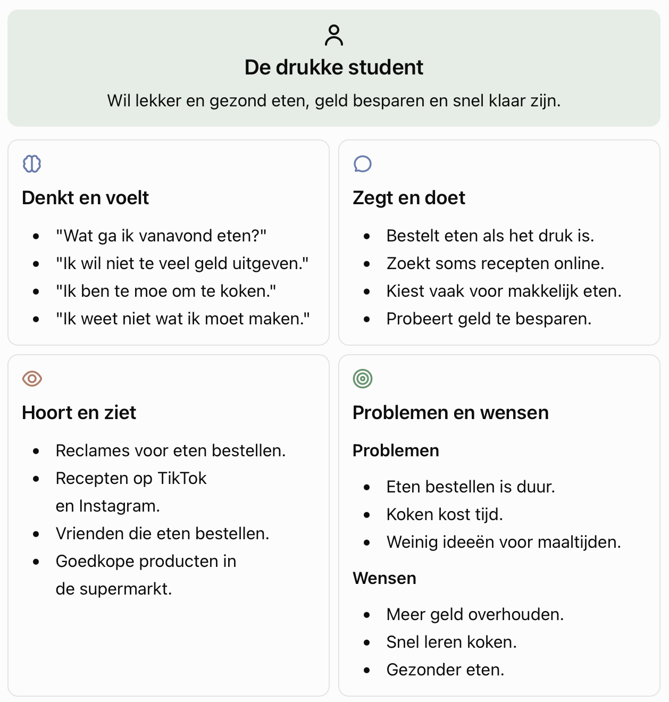

## Wie is onze gebruiker?

Onze doelgroep bestaat uit jonge studenten die het druk hebben met school, werk en hun sociale leven. Ze hebben vaak weinig geld en soms weinig ervaring met koken. Daarom bestellen ze regelmatig eten, omdat dit makkelijk en snel is.
Wij willen een website maken die studenten helpt om zelf lekker, gezond en goedkoop te koken.

## Pijnpunten (Pains)

Dit zijn de problemen waar studenten tegenaan lopen.

Weinig geld: Studenten hebben vaak een klein budget. Eten bestellen kost veel geld.

Weinig tijd: Studenten hebben het druk en willen niet lang koken.

Weinig ervaring met koken: Sommige studenten weten niet hoe ze zelf een maaltijd moeten maken.

Geen inspiratie: Studenten weten soms niet wat ze moeten koken.

Gezond eten lijkt moeilijk: Studenten denken soms dat gezond koken duur of ingewikkeld is.
Boodschappen doen: Studenten weten niet altijd welke producten ze nodig hebben.

 ## Behoeftes (Gains)

Dit zijn de dingen die studenten graag willen.

Goedkoop eten: Recepten die passen binnen een klein budget.

Snel koken: Maaltijden die binnen 15 tot 20 minuten klaar zijn.

Makkelijke recepten: Duidelijke uitleg die iedereen kan volgen.

Lekker en gezond eten: Maaltijden die lekker zijn en goed voor je lichaam.

Nieuwe ideeën: Inspiratie om verschillende maaltijden te maken.

Een boodschappenlijst: Een lijst met de producten die nodig zijn en wat ze ongeveer kosten.

## Empathy Map

Een empathy map helpt ons om beter te begrijpen wat studenten denken, voelen, zeggen en doen.

## Conclusie
Het belangrijkste inzicht is dat studenten vaak eten bestellen omdat het makkelijk en snel is. Zelf koken lijkt soms moeilijk, kost tijd en vraagt om geld voor boodschappen.

Studenten hebben daarom behoefte aan een website met goedkope, snelle en makkelijke recepten. De recepten moeten duidelijk worden uitgelegd en geschikt zijn voor mensen die weinig ervaring hebben met koken.

Met onze website willen we studenten helpen om minder geld uit te geven aan eten bestellen en vaker zelf een gezonde maaltijd te maken.

## Vraag voor de Define-fase
Hoe kunnen we drukke studenten met weinig geld helpen om snel, makkelijk en gezond zelf te koken?